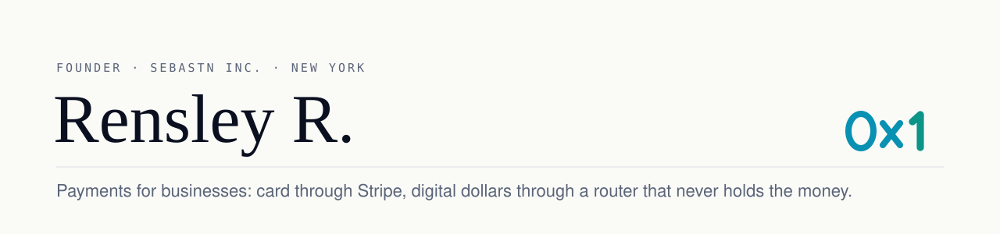

<picture>
  <source media="(prefers-color-scheme: dark)" srcset="./assets/header-dark.svg">
  
</picture>

Founder of SebasTN Inc. I am a full-stack engineer who works across three fields: **AI**, **data science** and **blockchain**. I build the whole system myself, from the model to the money:

- **Models that forecast.** Scoring and prediction from live business data: which businesses to approach next and why, what a customer is likely to book, where the fees should step. LLM assistants run inside the apps and are paid per use.
- **Apps that run businesses.** Production Next.js and TypeScript on AWS, serving real businesses in 24 languages and 41 countries.
- **Contracts that move the money.** Solidity in production on four chains: a non-custodial payment router and Uniswap v4 hooks, held to proofs, fuzzing and mutation tests.

### SebasTN Inc.

| | What it is |
|---|---|
| **[SebasTN](https://sebastn.com)** | The payments company: card and digital dollars, for any business. |
| **[Access0x1](https://access0x1.com)** | The non-custodial payment router. Live on Base, Ethereum, Unichain and Arc, owned by a 2-of-3 Safe. |
| **[ClickReserv](https://clickreserv.com)** | Booking and payments for appointment businesses, in 24 languages. |
| **[reserv.click](https://reserv.click)** | Short links and QR codes. |

### In production

| Contract | Networks | Address |
|---|---|---|
| Access0x1 router (UUPS proxy) | Base · Ethereum · Unichain · Arc | [`0xe922…5EB5`](https://basescan.org/address/0xe92244e3368561faf21648146511DeDE3a475EB5) |
| Owner: Safe, 2 of 3 | Base · Ethereum · Unichain · Arc | [`0xF025…9A91`](https://basescan.org/address/0xF025EC0bB828dbFD896c22142a323dD8606F9A91) |
| PayHook (Uniswap v4) | Base · Unichain · Arc | [`0xFDE0…4044`](https://basescan.org/address/0xFDE0bad6627D99d46c66D64D2f8F692e4a354044) |
| BoomerangHook (Uniswap v4): 5% of liquidity-provider fees to the treasury | Base · Ethereum · Unichain · Arc | [`0x3f69…0503`](https://basescan.org/address/0x3f6911635018bE4e2b8999287504676693290503) |

Every payment is on the public record at [access0x1.com/mainnet](https://access0x1.com/mainnet). Live health: [access0x1.com/status](https://access0x1.com/status). Prices are read from Chainlink feeds inside the transaction.

### How the money code is held to account

- Unit, fuzz and invariant suites in Foundry on every money path: the fee plus what the business receives always equals what the customer paid, and a refund can never be blocked.
- Symbolic proofs with Halmos, mutation testing, and static analysis with Slither and Aderyn.
- Upgrades go only through the Safe, and contract storage is append-only.

### Open source

- **[access0x1-snap](https://github.com/Access0x1/access0x1-snap)**: a MetaMask Snap that shows who you are paying, the fee and what the business receives, before you sign.
- Uniswap Hook Incubator, cohort 11.
- Access0x1 won an ENS prize at ETHGlobal: a payment resolver that turns an ENS name into a live payment address, read on chain from the router.
- NameMath: an on-chain avatar maker that gives every ENS name its own colour and identicon from its namehash, built at ETHGlobal New York.

### Contact

[sebastn.com](https://sebastn.com) · [Crunchbase](https://www.crunchbase.com/organization/sebastn) · [X](https://x.com/VyperPilledDev) · New York
